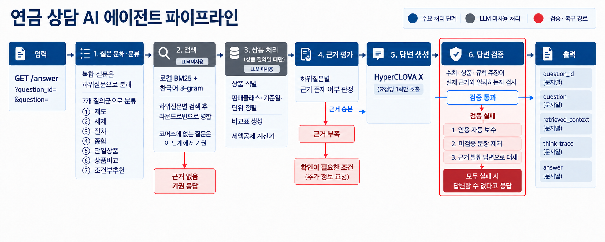

# 연금 어드바이저

연금 제도·세금·상품에 관한 질문에 답하는 에이전트입니다.
제공된 문서에서 필요한 내용을 찾고 세액공제 계산과 상품 비교는 별도 모듈로 처리하는 방식입니다.
답변에 인용된 문서와 처리 내역도 함께 반환하는 구조로 이루어져있습니다.

이 저장소에는 코드와 설정 예시만 포함합니다. API 키·인증 헤더·토큰은 로컬 `.env`에
설정합니다. 주최 측 원본, 검색 코퍼스, 상품 색인, 실제 질의·응답 캐시와 내부 작업 문서는
재배포하지 않습니다. 전체 검색·평가를 실행하려면 사용 권한이 있는 자료를 별도로 준비해야 합니다.

## 제출물

| 항목 | 경로 |
|---|---|
| 기술제안서 | [`TECHNICAL_PROPOSAL.md`](TECHNICAL_PROPOSAL.md) |
| 평가용 API 명세 | 아래 [요청과 응답](#요청과-응답) |
| 실행 코드 | `app/`, `agents/`, `scripts/` |
| 검색 코퍼스 (별도 준비, Git 제외) | `data/knowledge/`, `data/structured/` |
| 테스트·평가 | `tests/`, `benchmarks/` |
| 참고 연구 | `docs/paper/` |

## 평가용 API

아래 주소는 예시입니다. 실제 주소는 `.env`의 `EVALUATION_ENDPOINT`에만 설정하며,
배포 점검 스크립트도 그 값을 읽습니다.

```text
https://your-server.example/answer
```

```dotenv
EVALUATION_ENDPOINT=https://your-server.example/answer
```



## 동작 원리

1. 질문에 여러 내용이 섞여 있으면 각각 나눕니다.
2. 제도, 세금, 절차, 상품 중 무엇을 묻는지 파악합니다.
3. 질문에 필요한 문서와 상품 정보를 찾습니다.
4. 계산이나 상품 비교가 필요하면 해당 모듈을 실행합니다.
5. 찾은 자료와 계산 결과를 바탕으로 HyperCLOVA X가 답변을 작성합니다.
6. 답변의 수치, 상품명, 제도 설명과 출처가 자료와 맞는지 검사합니다.
7. 검사를 통과하지 못하면 인용을 보수하고, 그래도 남으면 확인되지 않은 문장을 덜어낸 뒤,
   마지막에는 확인된 자료만 발췌해 답합니다.

자료로 확인할 수 없는 내용은 임의로 채우지 않습니다. 계좌 잔액 조회나 상품 변경처럼
금융회사 시스템에 접속해야 하는 작업도 수행하지 않습니다.

## 기능

- DB형, DC형, IRP, 연금저축의 제도와 차이 설명
- 가입, 이전, 연금 개시, 중도인출에 필요한 조건 안내
- 연금계좌 납입액을 바탕으로 세액공제액 계산
- 연금상품의 위험등급·상품분류 비교, 동일 판매 클래스 기준의 보수·수익률 비교
- 투자 기간과 위험 감수 수준 등을 반영한 상품 후보 제시
- 여러 내용이 섞인 질문을 나누어 답변

띄어쓰기와 문장부호가 일정하지 않은 질문도 처리합니다. `6천만원`, `900만원`, `16.5%`처럼
연금 질문에 자주 쓰이는 금액과 비율 표기도 인식합니다.

## 요청과 응답

인증 헤더 없이 `GET /answer`로 요청합니다.

```http
GET /answer?question_id={질의 ID}&question={평가 질의}
```

```bash
curl -G "https://your-server.example/answer" \
  --data-urlencode "question_id=Q-001" \
  --data-urlencode "question=DB형과 DC형 퇴직연금의 차이를 설명해 주세요."
```

응답은 `application/json`이며 모든 값은 문자열입니다.

```json
{
  "question_id": "Q-001",
  "question": "DB형과 DC형 퇴직연금의 차이를 설명해 주세요.",
  "retrieved_context": "답변 생성에 참고한 검색 문서",
  "think_trace": "분류·검색·도구·검사 단계의 실행 요약",
  "answer": "출처가 표시된 최종 답변"
}
```

`question_id`와 `question`은 요청받은 값을 그대로 반환합니다. `think_trace`에는 사용한 기능,
검색한 문서 수와 검사 결과가 기록됩니다.

## 실행

### Docker Compose

```bash
cp .env.example .env
# .env에 운영 환경과 HyperCLOVA X 연결 정보를 입력합니다.
# 운영 모드에서는 APP_ENV=production, AGENT_BACKEND=hcx를 설정합니다.
# 사용 권한이 있는 코퍼스와 색인을 data/knowledge, data/structured에 준비합니다.

docker compose up -d --build pension-agent
docker compose ps
curl --fail http://127.0.0.1/livez
curl --fail http://127.0.0.1/readyz
```

기본 서비스 포트는 HTTP 80입니다. 실제 API 키는 `.env`에만 저장하며 Git에 포함하지 않습니다.

### 로컬 실행

```bash
python3.12 -m venv .venv
.venv/bin/pip install --require-hashes -r requirements-dev.lock
cp .env.example .env
# .env에 연결 정보를 입력합니다. 프로젝트 루트의 .env를 자동으로 읽습니다.
.venv/bin/python -m uvicorn app.main:app --host 0.0.0.0 --port 8000
```

## 테스트

검색 코퍼스·상품 색인에 의존하는 테스트와 벤치마크는 해당 자료를 별도로 준비해야 합니다.
원본 무결성 검사에는 `docs/official/`의 원본 자료와 문서 카탈로그도 필요합니다.
설정 관련 테스트만 실행하려면 `.venv/bin/python -m pytest tests/test_config.py`를 사용합니다.
배포 환경변수는 `.env`보다 우선하며, `.env` 값의 `${...}` 보간은 수행하지 않습니다.

```bash
.venv/bin/python -m pytest -q
.venv/bin/python scripts/run_benchmark_suite.py --profile quick
.venv/bin/python scripts/run_benchmark_suite.py --profile release
.venv/bin/python scripts/preflight.py
```

## 구조

```text
app/                API와 에이전트 실행 코드
agents/             프롬프트와 도구 사용 규칙
data/knowledge/     검색용 문서
data/structured/    상품과 출처 정보
benchmarks/         평가 항목과 예시 질문
scripts/            문서 처리, 테스트, 배포 점검 도구
tests/              기능 테스트
docs/               설계와 참고 자료
```
